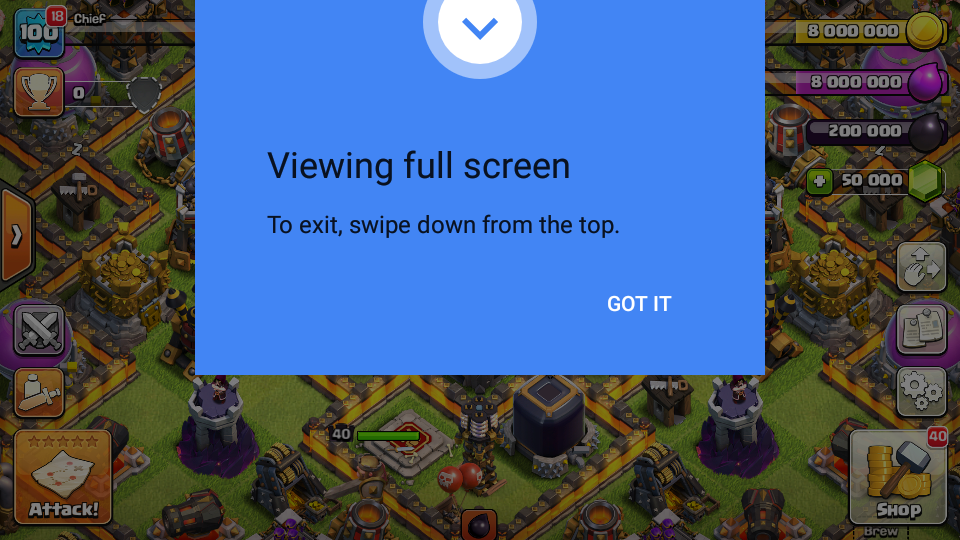
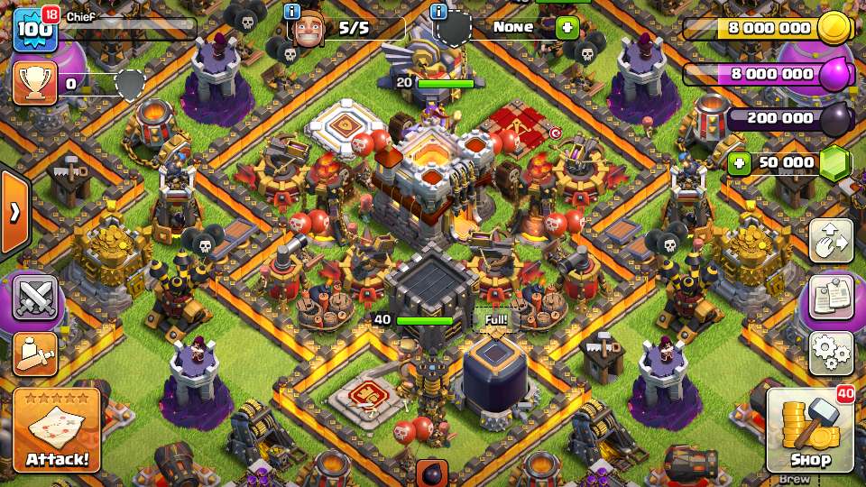
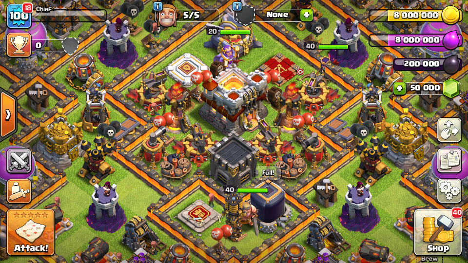
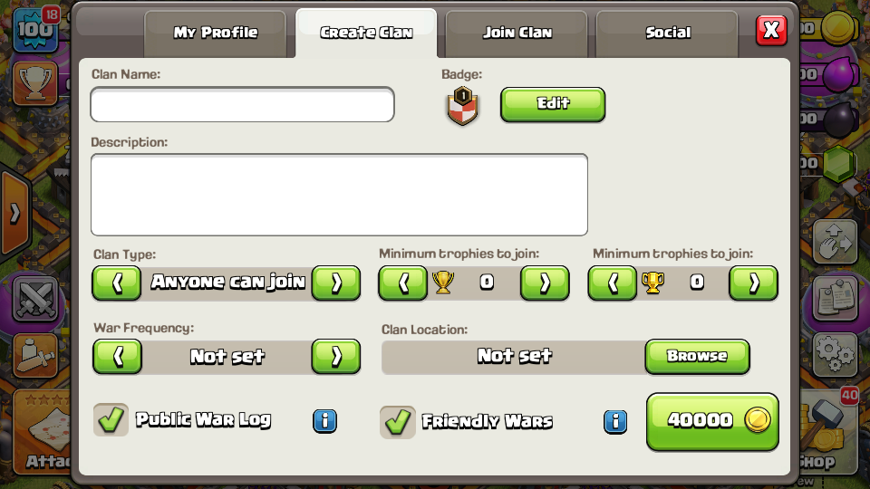
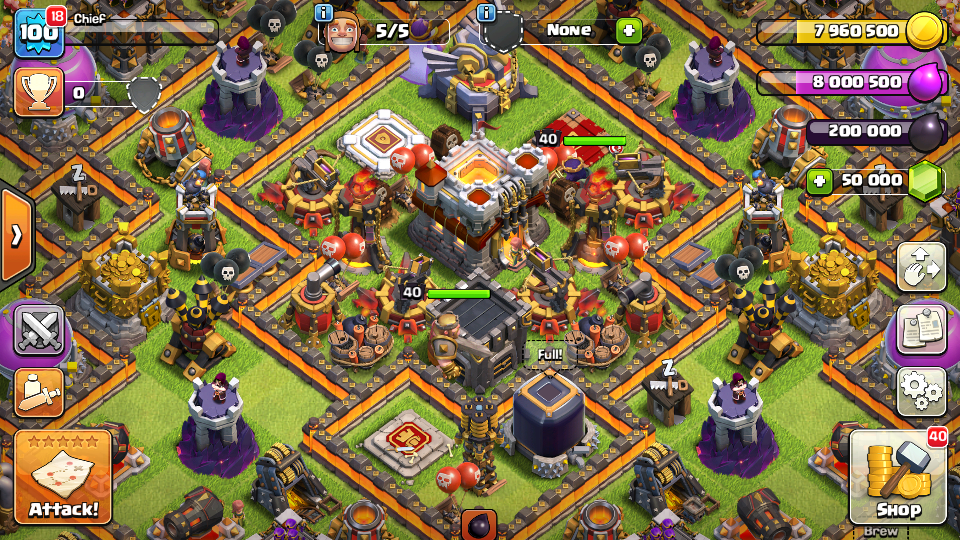
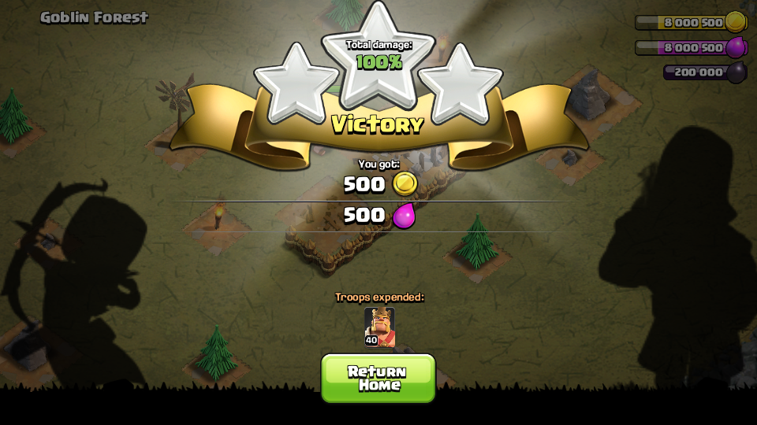
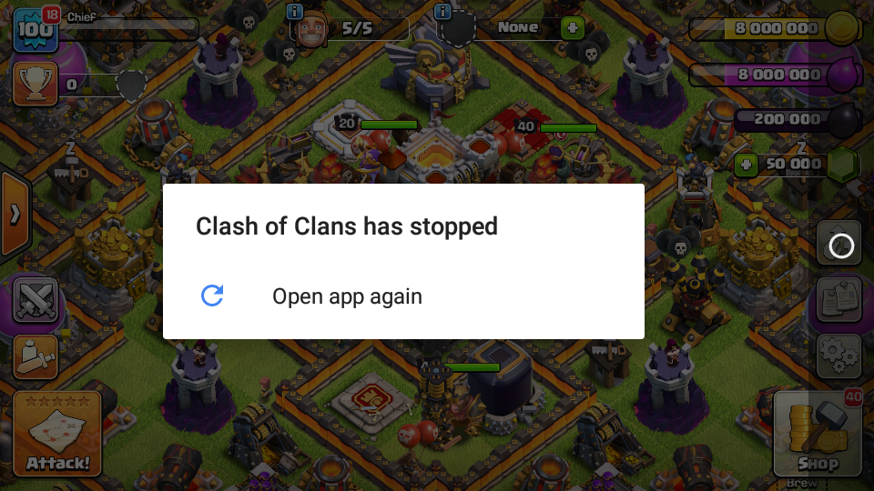

# coc-v9-offline

a clash of clans **9.256.8** offline mode client for android. based on the original v9 client with the offline logic built into the apk.

## features

- town hall 2 starting village
- auto saving
- local clans: create a clan, leave it and use clan chat
- single-player maps and offline battles
- `/gems` in clan chat gives you 10 million gems
- `.base #TAG` imports a public base when you're online

## screenshots

| village | saved village |
| --- | --- |
|  |  |
| upgrading a building | creating a clan |
|  |  |
| clan in the village | my clan |
|  |  |
| after leaving the clan | profile |
|  |  |
| attack map | goblin battle |
|  |  |
| victory | imported base |
|  |  |

## download

[download clash of clans v9.256.8 offline.apk](https://github.com/8133/coc-v9-offline/releases/download/v9.256.8/Clash.of.Clans.v9.256.8.offline.apk)

this whole thing was done using AI.
