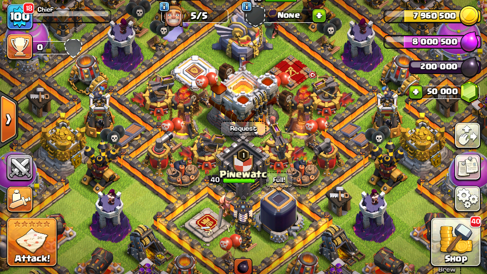
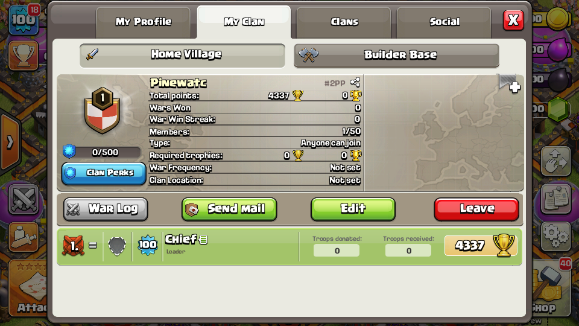
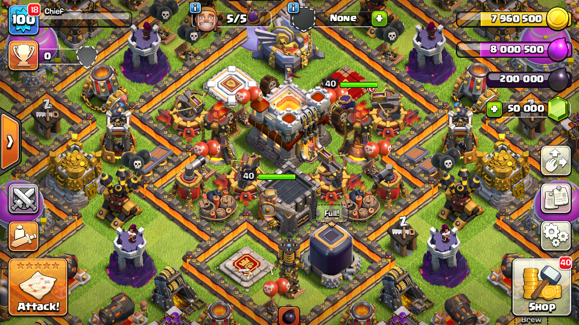
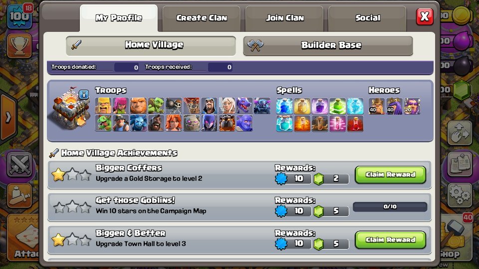
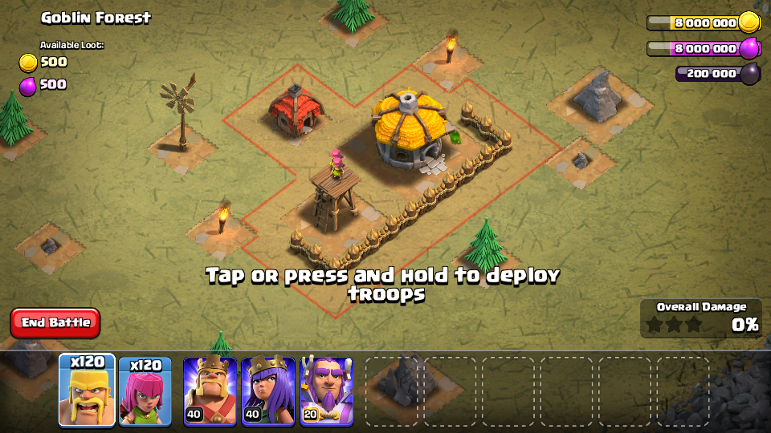

# coc-v9-offline

a clash of clans **9.256.8** offline mode client for android. based on the original v9 client with the offline logic built into the apk.

## features

- town hall 2 starting village
- auto saving
- local clans: create a clan, leave it and use clan chat
- single-player maps and offline battles
- `/gems` in clan chat gives you 10 million gems
- `.base #TAG` imports a public base when you're online

## screenshots

| saved village | upgrading a building |
| --- | --- |
|  |  |
| creating a clan | clan in the village |
|  |  |
| my clan | after leaving the clan |
|  |  |
| profile | attack map |
|  |  |
| goblin battle | victory |
|  |  |

## download

[download clash of clans v9.256.8 offline.apk](https://github.com/8133/coc-v9-offline/releases/download/v9.256.8/Clash.of.Clans.v9.256.8.offline.apk)

[Moded Verison 9.256.8](https://www.mediafire.com/file/33t97ke9ev789tk/Clash.of.Clans.v9.256.8.offline.apk/file)

this whole thing was done using AI.
